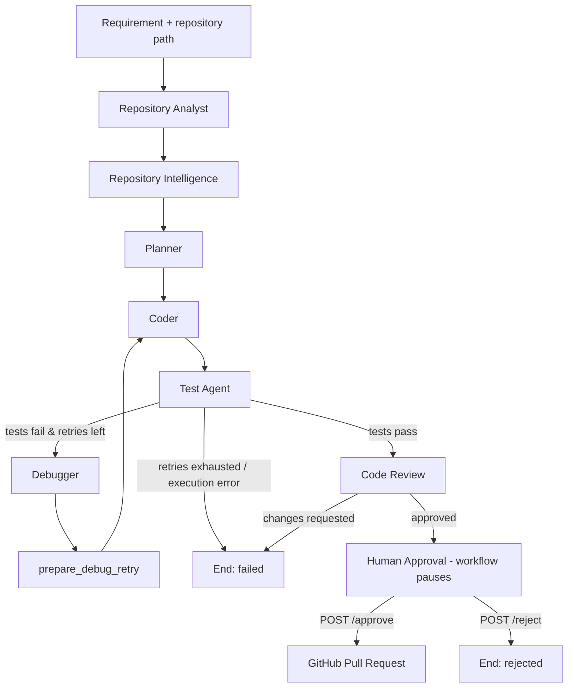

# 🤖 Autonomous Multi-Agent AI Software Engineer

An autonomous software-engineering workflow that takes a **natural-language requirement**, understands an existing Git repository, **plans, writes code, runs tests, debugs failures, reviews the change**, and — only after **explicit human approval** — opens a **GitHub Pull Request**.

It is built with **LangGraph** (stateful agent orchestration), **FastAPI** (backend API), **Groq** (free LLM inference) and a **Streamlit** dashboard for watching runs live.

> ⚠️ This is a portfolio / learning project. Generated code must always be reviewed by a human before merging. See [Limitations](#limitations).

---

## Table of contents

1. [Features](#features)
2. [Workflow](#workflow)
3. [Agents](#agents)
4. [Technologies used](#technologies-used)
5. [Project structure](#project-structure)
6. [Setup & run commands](#setup--run-commands)
7. [Environment variables](#environment-variables)
8. [Streamlit dashboard](#streamlit-dashboard)
9. [API reference](#api-reference)
10. [External APIs used](#external-apis-used)
11. [Testing](#testing)
12. [How it works (detailed)](#how-it-works-detailed)
13. [Safety & security notes](#safety--security-notes)
14. [Limitations](#limitations)
15. [Roadmap](#roadmap)

---

## Features

- **Repository analysis** – scans the target repository (skips `.git`, `.venv`, `node_modules`, `__pycache__`, `.pytest_cache`; blocks `.env`).
- **Repository intelligence** – LLM-assisted selection of relevant files plus an architecture summary.
- **Structured planning** – requirement → ordered tasks with files to create/modify, tests required and security considerations (validated with Pydantic).
- **Code generation** – the Coder creates/modifies only files authorised by the plan, through path-safe file tools.
- **Automated testing** – runs `pytest` in the target repository (local mode by default, optional Docker mode with resource limits).
- **Bounded self-correction loop** – failing tests → Debugger diagnosis → Coder repair → re-test, capped by `max_debug_retries` (0–10).
- **Code review** – LLM review with severity-rated issues, strengths and security concerns.
- **Human-in-the-loop** – the workflow pauses at `waiting_for_human_approval`; nothing touches GitHub until a human approves.
- **GitHub PR creation** – creates a branch, commits and opens (or detects an existing) pull request.
- **Persistence** – run state is saved to `run_store.json` and survives restarts.
- **Live dashboard** – Streamlit UI with pipeline progress, plan, diff, test output, review, timeline and Approve / Reject buttons.
- **Auth utilities** – JWT creation/verification and role helpers (`admin`, `user`, `guest`).

---

## Workflow



Text version:

```text
Requirement
   → Repository Analyst → Repository Intelligence → Planner → Coder → Test Agent
                                                                        │
                       ┌──────────── tests fail (retries left) ─────────┤
                       ▼                                                │ tests pass
                   Debugger → prepare_debug_retry → Coder               ▼
                                                                  Code Review
                                                                        │ approved
                                                                        ▼
                                                      Human Approval (pause) → GitHub PR
```

**Stopping conditions:** tests pass · retry budget exhausted · pytest could not start (`execution_error`) · debugger has no files to fix · review requests changes · a human rejects.

---

## Agents

| Agent | File | Responsibility |
|---|---|---|
| Repository Analyst | `backend/agents/repository.py` | Scans the repo and loads file contents into state |
| Repository Intelligence | `backend/agents/repository_intelligence.py` | Picks relevant files, summarises architecture |
| Planner | `backend/agents/planner.py` (+ `planner_models.py`) | Produces a validated implementation plan |
| Coder | `backend/agents/coder.py` | Writes/modifies files via safe filesystem tools; handles LLM rate limits with retry |
| Test Agent | `backend/agents/test_agent.py` | Runs pytest, classifies failures |
| Debugger | `backend/agents/debugger.py` | Analyses failures, lists files to fix and instructions |
| Code Review | `backend/agents/code_review.py` | Correctness, maintainability and security review |
| Human Approval | `backend/agents/human_approval.py` | Pauses the workflow for a human decision |
| GitHub PR service | `backend/github/pr_service.py` | Branch → commit → push → PR |

Each node is wrapped by `wrap_agent`, which records `started` / `completed` / `failed` **events** with timestamps (these feed the dashboard timeline) and converts exceptions into workflow errors.

---

## Technologies used

| Area | Technology |
|---|---|
| Language | Python 3.11+ |
| Agent orchestration | **LangGraph** (`StateGraph`, conditional edges), LangChain |
| LLM provider | **Groq** (`groq`, `langchain-groq`) — default model `openai/gpt-oss-20b` |
| Backend API | **FastAPI** + Uvicorn |
| Data validation | **Pydantic** |
| Frontend | **Streamlit** + `requests` |
| Auth | `python-jose` (JWT), `passlib[bcrypt]` |
| Testing | **Pytest** |
| Version control / PRs | Git + **GitHub REST API** |
| Config | `python-dotenv` |
| Optional sandbox | Docker (`--network none`, CPU/memory/PID limits) |

---

## Project structure

```text
AI-Software-Engineer/
├── backend/
│   ├── main.py                    # FastAPI app: run, status, approve/reject, live-run endpoints
│   ├── llm.py                     # Groq client / model configuration
│   ├── agents/
│   │   ├── repository.py          # Repository Analyst
│   │   ├── repository_intelligence.py
│   │   ├── planner.py
│   │   ├── planner_models.py      # Pydantic plan schemas
│   │   ├── coder.py
│   │   ├── test_agent.py
│   │   ├── debugger.py
│   │   ├── code_review.py
│   │   ├── human_approval.py
│   │   └── conftest.py
│   ├── graph/
│   │   ├── state.py               # AgentState (TypedDict) — shared workflow state
│   │   └── workflow.py            # LangGraph definition, routing, retry logic
│   ├── tools/
│   │   ├── filesystem.py          # Path-safe read/write, ignored dirs, blocked files
│   │   ├── repository.py          # Repository scanning helpers
│   │   └── test_runner.py         # Local / Docker pytest runner, target validation
│   ├── github/
│   │   ├── client.py              # GitHub REST client
│   │   └── pr_service.py          # Branch/commit/PR orchestration
│   ├── auth/
│   │   ├── jwt.py                 # Token creation / verification
│   │   ├── dependencies.py        # FastAPI auth dependencies
│   │   ├── roles.py               # admin / user / guest helpers
│   │   └── google.py              # Google OAuth helpers (development placeholder)
│   └── utils/health.py            # Health check
├── frontend/
│   └── app.py                     # Streamlit dashboard
├── tests/                         # 38 automated tests
│   ├── test_auth.py
│   ├── test_approval_api.py
│   ├── test_debugging.py
│   ├── test_github_client.py
│   ├── test_health.py
│   ├── test_human_approval.py
│   └── test_system.py
├── test-target-repo/              # Disposable repo to try the agent on
├── requirements.txt
├── pytest.ini
├── .env.example
├── .gitignore
├── LICENSE
└── README.md
```

---

## Setup & run commands

### 1. Clone and create a virtual environment

**Windows (PowerShell)**
```powershell
git clone https://github.com/Chirag0071/AI-Software-Engineer.git
cd AI-Software-Engineer
py -3.11 -m venv .venv
.\.venv\Scripts\Activate.ps1
```

**Linux / macOS**
```bash
git clone https://github.com/Chirag0071/AI-Software-Engineer.git
cd AI-Software-Engineer
python3 -m venv .venv
source .venv/bin/activate
```

### 2. Install dependencies
```bash
python -m pip install --upgrade pip
pip install -r requirements.txt
```

### 3. Configure environment
```bash
cp .env.example .env        # Windows: copy .env.example .env
```
Then edit `.env` (see [Environment variables](#environment-variables)). A free Groq key is available at <https://console.groq.com>.

### 4. Prepare a target repository
The agent edits a **separate** Git repository. Use a disposable one:
```bash
mkdir test-target-repo && cd test-target-repo
git init
printf 'def add(a, b):\n    return a + b\n' > app.py
git add . && git commit -m "init"
cd ..
```

### 5. Start the backend (terminal 1)
```bash
uvicorn backend.main:app --reload
```
- Swagger UI: <http://127.0.0.1:8000/docs>
- Health: <http://127.0.0.1:8000/health>

### 6. Start the dashboard (terminal 2)
```bash
streamlit run frontend/app.py
```
Open <http://localhost:8501>. If the backend is not on the default address:
```bash
BACKEND_URL=http://127.0.0.1:8000 streamlit run frontend/app.py
```

### 7. Run the tests
```bash
# Linux / macOS
PYTEST_DISABLE_PLUGIN_AUTOLOAD=1 python -m pytest -q
```
```powershell
# Windows PowerShell
$env:PYTEST_DISABLE_PLUGIN_AUTOLOAD = "1"
python -m pytest -q
```

### Optional: Docker execution mode
```bash
EXECUTION_MODE=docker SANDBOX_DOCKER_IMAGE=ai-software-engineer-sandbox:latest uvicorn backend.main:app
```
Requires Docker and a sandbox image containing Python and pytest (image build file is not included yet).

---

## Environment variables

| Variable | Required | Purpose |
|---|---|---|
| `LLM_PROVIDER` | No (default `groq`) | Only `groq` is supported |
| `GROQ_API_KEY` | **Yes** | Groq API key |
| `MODEL` | No (default `openai/gpt-oss-20b`) | Groq model name |
| `SECRET_KEY` | **Yes** | Signs JWT tokens — use a long random value |
| `GITHUB_TOKEN` | For PRs | Token with repo permissions |
| `GITHUB_OWNER` | For PRs | GitHub user/org that owns the target repo |
| `GITHUB_REPO` | For PRs | Target repository name |
| `GITHUB_BASE_BRANCH` | No (default `main`) | Branch PRs are opened against |
| `GOOGLE_CLIENT_ID` / `GOOGLE_CLIENT_SECRET` | No | Only for the Google OAuth helper |
| `EXECUTION_MODE` | No (default `local`) | `local` or `docker` |
| `TEST_TIMEOUT_SECONDS` | No (default `120`) | Test run timeout |
| `SANDBOX_DOCKER_IMAGE` | No | Docker image for sandboxed tests |
| `SANDBOX_CPUS` / `SANDBOX_MEMORY` / `SANDBOX_PIDS` | No | Docker limits (`1` / `512m` / `128`) |
| `BACKEND_URL` | No | Used by the Streamlit app (default `http://127.0.0.1:8000`) |

> **Never commit `.env`.** Keep tokens out of source control.

---

## Streamlit dashboard

1. Enter the **repository path** and a **requirement** in the sidebar, choose max debug retries, press **🚀 Start run**.
2. Watch the **pipeline strip** (Analyst → Intelligence → Planner → Coder → Tests → Debugger → Review → Approval) update live (refreshes every 2 s).
3. Inspect the tabs:

| Tab | Shows |
|---|---|
| 📋 Plan | Plan summary and task breakdown |
| 📂 Context | Repository summary, architecture, relevant files |
| 🧾 Changes | Created/modified files and the real `git diff` |
| 🧪 Tests | Pytest output, duration, sandbox mode, debugger diagnosis |
| 🔎 Review | Review verdict, severity-tagged issues, security concerns |
| 🕒 Timeline | Per-agent started / completed / failed events |
| ✅ Approval | Approve & create PR / Reject controls |

The header shows status, current step, debug retries used and test status. Previous runs can be reopened from the sidebar.

---

## API reference

Base URL: `http://127.0.0.1:8000` — interactive docs at `/docs`.

| Method | Endpoint | Description |
|---|---|---|
| GET | `/` | Project info |
| GET | `/health` | Health check (`status`, `workflow`) |
| POST | `/run` | Run the full workflow **synchronously**; returns the final result |
| POST | `/run/start` | Start a run in the **background**; returns `run_id` immediately |
| GET | `/runs` | List runs (id, requirement, step, running flag) |
| GET | `/runs/{run_id}` | Summary status of a run |
| GET | `/runs/{run_id}/full` | Full run state (plan, events, tests, review…) — used by the dashboard |
| POST | `/runs/{run_id}/approve` | Approve a run waiting for approval and create the GitHub PR |
| POST | `/runs/{run_id}/reject` | Reject a run |
| GET | `/auth/google/login` | Placeholder Google OAuth URL |
| GET | `/auth/google/callback?code=` | **Development placeholder** that issues a JWT |
| GET | `/protected` | Example admin-only route (JWT, role `admin`) |

**Start a run**
```bash
curl -X POST http://127.0.0.1:8000/run/start \
  -H "Content-Type: application/json" \
  -d '{"requirement":"Add a multiply(a, b) function to app.py and add pytest tests","repository_path":"/path/to/test-target-repo","max_debug_retries":3}'
```

**Approve**
```bash
curl -X POST http://127.0.0.1:8000/runs/<run_id>/approve \
  -H "Content-Type: application/json" \
  -d '{"reviewer":"human","comment":"Reviewed and approved."}'
```

**Run status values:** `waiting_for_approval`, `review_approved`, `testing_complete`, `completed`, `failed`.

---

## External APIs used

| API | Used for |
|---|---|
| **Groq API** (OpenAI-compatible chat completions, via `groq` and `langchain-groq`) | Planning, repository intelligence, coding, debugging, code review |
| **GitHub REST API** (`https://api.github.com`) | Creating branches, commits and pull requests |
| **Google OAuth 2.0** | Placeholder endpoints only — not a production integration |

---

## Testing

**38 automated tests — 38 passed** (`pytest -q`, ~3 s).

| Test file | Tests | Covers |
|---|---:|---|
| `tests/test_github_client.py` | 13 | GitHub client behaviour |
| `tests/test_debugging.py` | 8 | Debugger / retry logic |
| `tests/test_approval_api.py` | 7 | Approve / reject API |
| `tests/test_auth.py` | 4 | JWT and auth |
| `tests/test_system.py` | 3 | Planner schemas and normalisation |
| `tests/test_human_approval.py` | 2 | Approval agent gate |
| `tests/test_health.py` | 1 | Health contract |
| **Total** | **38** | |

The live dashboard and background-run endpoints were additionally verified end to end using stubbed agents (no LLM calls). Real LLM output quality depends on the model and has not been benchmarked yet — see [Roadmap](#roadmap).

---

## How it works (detailed)

1. **State.** All agents read and write a single `AgentState` (requirement, repository path, plan, files, test results, debugger result, review results, approval and GitHub results, retry counters, errors, events).
2. **Graph.** `backend/graph/workflow.py` builds a LangGraph `StateGraph`. Conditional edges decide the next node (`route_testing`, `route_debugger`, `route_code_review`, …).
3. **Retry loop.** On failing tests the Debugger proposes `files_to_fix` and `fix_instructions`; `prepare_debug_retry` increments `debug_retry_count` and sends control back to the Coder. When `debug_retry_count >= max_debug_retries` the run ends.
4. **Tools.** File access goes through `get_safe_path` (rejects paths outside the repository); test targets are validated to be existing `.py` files inside the repo and may not start with `-`.
5. **Approval gate.** `human_approval_agent` marks the run `waiting_for_human_approval` only when the review status is `approved`. The PR is created only from `POST /runs/{id}/approve`.
6. **Live runs.** `POST /run/start` executes `workflow.stream(...)` in a background thread and stores the latest state after every node, so `GET /runs/{id}/full` reflects progress in real time.
7. **Persistence.** State is written atomically to `run_store.json`.

---

## Safety & security notes

- Only run against repositories you own or are authorised to modify; use a disposable checkout.
- **Local test mode executes code from the target repository on your machine.** Use Docker mode or an isolated environment for untrusted code.
- Rate-limit handling for Groq is built into the Coder (retry/wait), but free-tier limits may still interrupt long runs.
- `run_store.json` may contain paths, requirements and generated code — keep it out of Git (add it to `.gitignore`).
- The `/auth/google/callback` endpoint is a **development placeholder**: it issues a token without verifying the Google code. Do **not** expose it publicly.
- The approve/reject endpoints are not currently protected by JWT roles. Add authentication before exposing the API beyond localhost.

---

## Limitations

- Output quality depends on the Groq model (the default is a small model); complex multi-file tasks may fail or need several retries.
- No vector search / embeddings: repository context selection is LLM-based, not RAG.
- No database: runs are stored in a JSON file; runs execute in-process threads (no job queue).
- Test execution is local by default; the Docker sandbox image is not yet provided.
- No dedicated Security Agent (security concerns come from the Code Review agent) and no Documentation Agent.
- No automated benchmark or cost/latency tracking yet, so no performance numbers are claimed.
- Python projects with `pytest` only.

---

## Roadmap

- [ ] Dedicated Security Agent
- [ ] Benchmark suite of small tasks with measured success rate, retries and latency
- [ ] Token / cost / latency tracking on the dashboard
- [ ] Dockerfile and sandbox image; `docker-compose` setup
- [ ] GitHub Actions CI (pytest on every push)
- [ ] Lightweight RAG with local embeddings
- [ ] SQLite/PostgreSQL storage for runs and events
- [ ] Real Google OAuth and JWT protection on approval endpoints
- [ ] Dashboard screenshots and demo video

---

## License

See [LICENSE](LICENSE).
