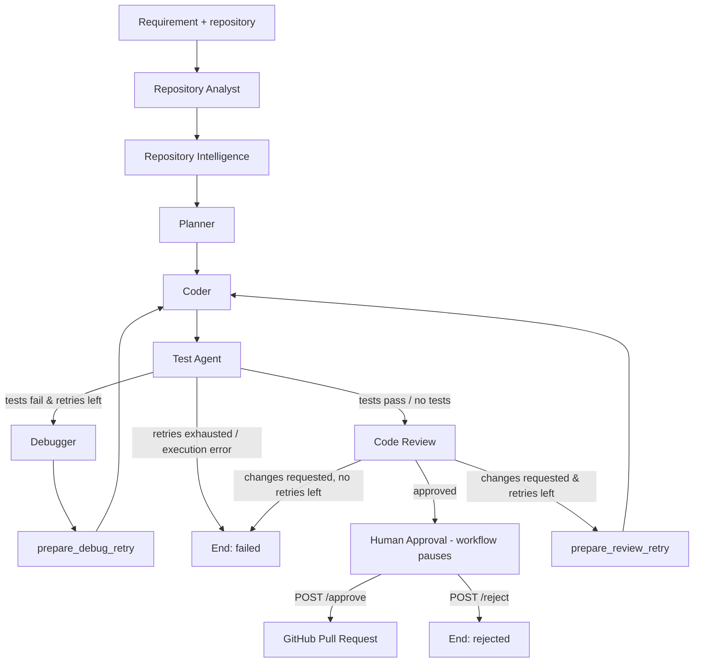

# 🤖 Autonomous Multi-Agent AI Software Engineer

An autonomous software-engineering workflow that takes a **natural-language requirement**, understands an existing Git repository, **plans, writes code, runs tests, debugs failures, reviews the change**, and — only after **explicit human approval** — opens a **GitHub Pull Request**.

Built with **LangGraph** (stateful agent orchestration), **FastAPI** (backend API), an **OpenAI-compatible LLM provider** (OpenRouter, Google Gemini or NVIDIA) and a **Streamlit** dashboard for watching runs live.

> ⚠️ Portfolio / learning project. Generated code must always be reviewed by a human before merging. See [Limitations](#limitations).

---

## Table of contents

1. [Features](#features)
2. [Workflow](#workflow)
3. [Agents](#agents)
4. [Technologies used](#technologies-used)
5. [Project structure](#project-structure)
6. [Setup & run (local)](#setup--run-local)
7. [Environment variables](#environment-variables)
8. [Choosing an LLM](#choosing-an-llm)
9. [Streamlit dashboard](#streamlit-dashboard)
10. [API reference](#api-reference)
11. [Deploying on Render](#deploying-on-render)
12. [Testing](#testing)
13. [How it works (detailed)](#how-it-works-detailed)
14. [Safety & security notes](#safety--security-notes)
15. [Troubleshooting](#troubleshooting)
16. [Limitations](#limitations)
17. [Roadmap](#roadmap)

---

## Features

- **Repository analysis** – scans the target repository (skips `.git`, `.venv`, `node_modules`, `__pycache__`, `.pytest_cache`; blocks `.env`).
- **Repository intelligence** – LLM-assisted selection of relevant files plus an architecture summary. Invalid or hallucinated file names are dropped instead of aborting the run.
- **Structured planning** – requirement → ordered tasks with files to create/modify, tests required and security considerations (validated with Pydantic). File lists are corrected against the real repository: an existing (even empty) file is *modified*, a missing one is *created*.
- **Code generation** – the Coder writes only files authorised by the plan, through path-safe file tools. Whether a file is created or modified is decided from what is on disk, not from the model's label. A rejected answer is sent back to the model with the reason.
- **Automated testing** – runs `pytest` in the target repository (local mode by default, optional Docker mode). API keys and tokens are removed from the environment of the generated code. If no tests exist, the run continues with a visible **NO TESTS** warning.
- **Bounded self-correction loops**
  - failing tests → Debugger diagnosis → Coder repair → re-test (`max_debug_retries`, 0–10)
  - reviewer requests changes → Coder fixes the reported issues → re-test → re-review (up to 2 times)
- **Code review** – LLM review with severity-rated issues, strengths and security concerns. Reviews that contain only cosmetic suggestions go on to the human.
- **Human-in-the-loop** – the workflow pauses at `waiting_for_human_approval`; nothing touches GitHub until a human approves.
- **GitHub PR creation** – creates (or resumes) a branch, commits only the files the run changed, pushes with your token and opens (or finds) the pull request. A failed approval can be retried.
- **Persistence** – run state is saved to `run_store.json` after every step (thread-safe). Runs interrupted by a server restart are marked failed instead of showing "running" forever.
- **Live dashboard** – Streamlit UI with pipeline progress, plan, diff, test output, review, timeline and Approve / Reject controls.
- **API key protection** – set `APP_API_KEY` to require an `X-API-Key` header on every endpoint (including approve/reject).
- **Auth utilities** – JWT creation/verification and role helpers (`admin`, `user`, `guest`).

---

## Workflow



**Stopping conditions:** debug retry budget exhausted · pytest could not start (`execution_error`) · debugger has no files to fix · review retry budget exhausted · a human rejects.

---

## Agents

| Agent | File | Responsibility |
|---|---|---|
| Repository Analyst | `backend/agents/repository.py` | Scans the repo and loads file contents into state |
| Repository Intelligence | `backend/agents/repository_intelligence.py` | Picks relevant files, summarises architecture |
| Planner | `backend/agents/planner.py` (+ `planner_models.py`) | Produces a validated, repo-consistent implementation plan |
| Coder | `backend/agents/coder.py` | Writes/modifies files via safe filesystem tools; retries with feedback and handles rate limits |
| Test Agent | `backend/agents/test_agent.py` | Runs pytest, classifies failures |
| Debugger | `backend/agents/debugger.py` | Analyses failures, lists files to fix and instructions |
| Code Review | `backend/agents/code_review.py` | Correctness, maintainability and security review |
| Human Approval | `backend/agents/human_approval.py` | Pauses the workflow for a human decision |
| GitHub PR service | `backend/github/pr_service.py` | Branch → commit → push → PR |

Each node is wrapped by `wrap_agent`, which records `started` / `completed` / `failed` **events** with timestamps (these feed the dashboard timeline) and converts exceptions into workflow errors.

---

## Technologies used

| Area | Technology |
|---|---|
| Language | Python 3.11+ |
| Agent orchestration | **LangGraph** (`StateGraph`, conditional edges), LangChain |
| LLM providers | **OpenRouter**, **Google Gemini**, **NVIDIA** (all via the OpenAI-compatible API) |
| Backend API | **FastAPI** + Uvicorn |
| Data validation | **Pydantic** |
| Frontend | **Streamlit** + `requests` |
| Auth | `python-jose` (JWT), `passlib[bcrypt]` |
| Testing | **Pytest** |
| Version control / PRs | Git + **GitHub REST API** |
| Config | `python-dotenv` |
| Optional sandbox | Docker (`--network none`, CPU/memory/PID limits) |

---

## Project structure

```text
AI-Software-Engineer/
├── backend/
│   ├── main.py                    # FastAPI app: run, status, approve/reject, live runs, diff
│   ├── llm.py                     # Provider, model and request configuration
│   ├── agents/
│   │   ├── repository.py          # Repository Analyst
│   │   ├── repository_intelligence.py
│   │   ├── planner.py
│   │   ├── planner_models.py      # Pydantic plan schemas
│   │   ├── coder.py
│   │   ├── test_agent.py
│   │   ├── debugger.py
│   │   ├── code_review.py
│   │   ├── human_approval.py
│   │   └── conftest.py
│   ├── graph/
│   │   ├── state.py               # AgentState (TypedDict) — shared workflow state
│   │   └── workflow.py            # LangGraph definition, routing, retry loops
│   ├── tools/
│   │   ├── filesystem.py          # Path-safe read/write, ignored dirs, blocked files
│   │   ├── repository.py          # Repository scanning helpers
│   │   └── test_runner.py         # Local / Docker pytest runner (secret-free environment)
│   ├── github/
│   │   ├── client.py              # GitHub REST + authenticated git client
│   │   └── pr_service.py          # Branch/commit/push/PR orchestration
│   ├── auth/
│   │   ├── jwt.py                 # Token creation / verification
│   │   ├── dependencies.py        # FastAPI auth dependencies
│   │   ├── roles.py               # admin / user / guest helpers
│   │   └── google.py              # Google OAuth helpers (development placeholder)
│   └── utils/health.py            # Health check
├── frontend/
│   └── app.py                     # Streamlit dashboard
├── tests/                         # automated tests (see Testing)
├── test-target-repo/              # Optional local scratch repo (keep out of this repo's Git)
├── requirements.txt
├── pytest.ini
├── .env.example
├── .gitignore
├── LICENSE
└── README.md
```

---

## Setup & run (local)

### 1. Clone and create a virtual environment

**Windows (PowerShell)**
```powershell
git clone https://github.com/Chirag0071/AI-Software-Engineer.git
cd AI-Software-Engineer
py -3.11 -m venv .venv
.\.venv\Scripts\Activate.ps1
```

**Linux / macOS**
```bash
git clone https://github.com/Chirag0071/AI-Software-Engineer.git
cd AI-Software-Engineer
python3 -m venv .venv
source .venv/bin/activate
```

### 2. Install dependencies
```bash
python -m pip install --upgrade pip
pip install -r requirements.txt
```

### 3. Configure environment
```bash
cp .env.example .env        # Windows: copy .env.example .env
```
Edit `.env` (see [Environment variables](#environment-variables)). For a purely **local** run:
- add your LLM provider key and `SECRET_KEY`,
- **leave `APP_API_KEY` and `BACKEND_URL` out** (the dashboard does not read `.env`; with a key set on the backend only, every dashboard request would return 401).

### 4. Choose a target repository
The agent works on a **separate** repository. Give it either a public/private GitHub URL (it is cloned into a temporary workspace) or a local path. Use a disposable repo while testing, for example:

```bash
mkdir test-target-repo && cd test-target-repo
git init
printf 'def add(a, b):\n    return a + b\n' > app.py
git add . && git commit -m "init"
cd ..
```

### 5. Start the backend (terminal 1, from the project root)
```bash
uvicorn backend.main:app --reload
```
- Swagger UI: <http://127.0.0.1:8000/docs>
- Health: <http://127.0.0.1:8000/health>

### 6. Start the dashboard (terminal 2, from the project root)
```bash
streamlit run frontend/app.py
```
Open <http://localhost:8501>. If the backend is not on the default address:
```bash
BACKEND_URL=http://127.0.0.1:8000 streamlit run frontend/app.py
```

### 7. Run the tests
```bash
python -m pytest -q
```

### Optional: Docker execution mode
```bash
EXECUTION_MODE=docker SANDBOX_DOCKER_IMAGE=ai-software-engineer-sandbox:latest uvicorn backend.main:app
```
Requires Docker and a sandbox image that contains Python and pytest (the image build file is not included yet).

---

## Environment variables

| Variable | Required | Purpose |
|---|---|---|
| `LLM_PROVIDER` | No (default `openrouter`) | `openrouter`, `gemini` or `nvidia` |
| `MODEL` | No | Model id for the chosen provider (one model for every agent). Defaults: `nvidia/nemotron-3-ultra-550b-a55b:free` (openrouter), `gemini-3.8-flash` (gemini), `openai/gpt-oss-20b` (nvidia) |
| `OPENROUTER_API_KEY` / `GEMINI_API_KEY` (or `GOOGLE_API_KEY`) / `NVIDIA_API_KEY` | **Yes** (the one for your provider) | Provider API key |
| `LLM_BASE_URL` | No | Override the provider's API endpoint |
| `LLM_TIMEOUT_SECONDS` / `LLM_CLIENT_RETRIES` | No (`120` / `2`) | Request timeout and SDK retries |
| `LLM_MAX_CONTEXT_CHARS` / `LLM_MAX_FILE_CHARS` | No (`120000` / `20000`) | Repository Intelligence context limits |
| `LLM_MAX_OUTPUT_TOKENS` / `LLM_MAX_OUTPUT_TOKENS_<AGENT>` | No | Completion limit override, optionally per agent |
| `SECRET_KEY` | **Yes** | Signs JWT tokens — a long random value |
| `APP_API_KEY` | Recommended when deployed | If set, every request (except `/`, `/health`, `/docs`) must send the same value in an `X-API-Key` header |
| `GITHUB_TOKEN` | For PRs | Fine-grained token with **Contents** and **Pull requests** read/write on the target repo |
| `GITHUB_OWNER` / `GITHUB_REPO` | Fallback | Used only if the repo's `origin` is not a GitHub URL; otherwise the PR targets the repository that was cloned |
| `GITHUB_BASE_BRANCH` | No (`main`) | Branch PRs are opened against |
| `GIT_AUTHOR_NAME` / `GIT_AUTHOR_EMAIL` | No | Identity for the commit the agent makes |
| `GOOGLE_CLIENT_ID` / `GOOGLE_CLIENT_SECRET` | No | Only for the Google OAuth helper |
| `EXECUTION_MODE` | No (`local`) | `local` or `docker` |
| `TEST_TIMEOUT_SECONDS` | No (`120`) | Test run timeout |
| `SANDBOX_DOCKER_IMAGE` | No | Docker image for sandboxed tests |
| `SANDBOX_CPUS` / `SANDBOX_MEMORY` / `SANDBOX_PIDS` | No (`1` / `512m` / `128`) | Docker limits |
| `BACKEND_URL` | Dashboard only | Backend address (default `http://127.0.0.1:8000`) |

`SECRET_KEY` and `APP_API_KEY` do different jobs and must be **different** random values. Generate each with:
```bash
python -c "import secrets; print(secrets.token_urlsafe(32))"
```

> **Never commit `.env` or paste real keys into chats, issues or screenshots.** If a key was exposed, create a new one at the provider — editing characters of the old one does not rotate it.

---

## Choosing an LLM

Every agent uses one model. The model must be able to return long, valid JSON that contains whole files, so tiny, safety, translation or vision models do not work.

| Provider | Setup | Notes |
|---|---|---|
| **Gemini** | `LLM_PROVIDER=gemini`, `MODEL=<id>`, `GEMINI_API_KEY` | Fast with a large context. The free tier meters requests **per day, per model** (a Flash-Lite model allows far more than a full Flash model). One run makes roughly 10–15 calls. Google retires model ids quickly — copy the current id from Google AI Studio. |
| **NVIDIA** | `LLM_PROVIDER=nvidia`, `MODEL=openai/gpt-oss-20b`, `NVIDIA_API_KEY` | Check the free limits for your account at build.nvidia.com. |
| **OpenRouter** | `LLM_PROVIDER=openrouter`, `OPENROUTER_API_KEY` | Free models are heavily rate limited, and very large ones (such as Nemotron Ultra) are slow. |

Groq's free tier caps tokens per minute (about 8K for the larger models), which is smaller than a single prompt from this project, so it is not a good fit on the free plan.

---

## Streamlit dashboard

1. Open **New run**, enter a **repository path or GitHub URL** and a **requirement**, choose the max debug retries, press **🚀 Start run**.
2. Watch the **pipeline strip** (Analyse → Context → Plan → Code → Test → Debug → Review → Approve) update live (refreshes every 2 s).
3. Inspect the tabs:

| Tab | Shows |
|---|---|
| Plan | Plan summary, task breakdown, architecture |
| Changes | Created/modified files and the real `git diff` (shown once the run is no longer active) |
| Tests | Pytest output, duration, sandbox mode, a **PASSING / FAILING / NO TESTS** badge |
| Review | Review verdict, severity-tagged issues, security concerns |
| Timeline | Per-agent started / completed / failed events |

The side cards show tests, debug retries used, files changed and security concerns. When a run reaches `waiting_for_human_approval`, the **Approve & create PR** and **Reject** controls become available. Previous runs can be reopened from the sidebar.

**Tip:** name the files you want in the requirement, for example *"Build a food delivery home page using app.html, scripts.css and app.js, and link the stylesheet in the HTML."* Empty files that already exist in the repo are modified; any other name is created.

---

## API reference

Base URL: `http://127.0.0.1:8000` — interactive docs at `/docs`. When `APP_API_KEY` is set, send `X-API-Key: <value>` on every request except `/`, `/health` and `/docs`.

| Method | Endpoint | Description |
|---|---|---|
| GET | `/` | Project info |
| GET | `/health` | Health check |
| POST | `/run` | Run the full workflow **synchronously**; returns the final result |
| POST | `/run/start` | Start a run in the **background**; returns `run_id` immediately |
| GET | `/runs` | List runs (id, requirement, step, running flag) |
| GET | `/runs/{run_id}` | Summary status of a run |
| GET | `/runs/{run_id}/full` | Full run state (plan, events, tests, review…) — used by the dashboard |
| GET | `/runs/{run_id}/diff` | `git diff` of the files this run created or changed |
| POST | `/runs/{run_id}/approve` | Approve a run waiting for approval (or retry after `github_pr_failed`) and create the PR |
| POST | `/runs/{run_id}/reject` | Reject a run |
| GET | `/auth/google/login` | Placeholder Google OAuth URL |
| GET | `/auth/google/callback?code=` | **Development placeholder** that issues a JWT without verifying the code |
| GET | `/protected` | Example admin-only route (JWT, role `admin`) |

**Start a run** (`repository_path` may be a local path or a GitHub URL)
```bash
curl -X POST http://127.0.0.1:8000/run/start \
  -H "Content-Type: application/json" \
  -H "X-API-Key: $APP_API_KEY" \
  -d '{"requirement":"Add a multiply(a, b) function to app.py and add pytest tests","repository_path":"https://github.com/<owner>/<repo>","max_debug_retries":3}'
```

**Approve**
```bash
curl -X POST http://127.0.0.1:8000/runs/<run_id>/approve \
  -H "Content-Type: application/json" \
  -H "X-API-Key: $APP_API_KEY" \
  -d '{"reviewer":"human","comment":"Reviewed and approved."}'
```

**Run step values** include: `repository_analysis_complete`, `repository_intelligence_complete`, `planning_complete`, `coding_complete`, `testing_complete`, `debugging_complete`, `debug_retry`, `review_retry`, `code_review_complete`, `waiting_for_human_approval`, `human_approval_approved`, `human_approval_rejected`, `github_pr_created`, `github_pr_failed`, and `<stage>_failed` / `workflow_failed` for errors.

---

## Deploying on Render

Run **two** services from the same repository.

| | Backend (Web Service) | Dashboard (Web Service) |
|---|---|---|
| Start command | `uvicorn backend.main:app --host 0.0.0.0 --port $PORT` | `streamlit run frontend/app.py --server.port $PORT --server.address 0.0.0.0` |
| Environment | `LLM_PROVIDER`, `MODEL`, the provider key, `SECRET_KEY`, `APP_API_KEY`, `GITHUB_TOKEN`, `GITHUB_BASE_BRANCH`, `PYTHON_VERSION` | `BACKEND_URL` (the backend's Render URL), `APP_API_KEY` (**same value as the backend**) |

- Render does not read your `.env` file (it is not in Git). Enter each variable in the service's **Environment** tab and redeploy after changing any.
- The free plan sleeps when idle (the first request can take about a minute) and has an **ephemeral disk**. Runs persist while the service is up; a run caught in the middle of a restart is marked failed and must be started again.
- Use a fine-grained GitHub token limited to the repositories you want the agent to change.

---

## Testing

```bash
python -m pytest -q
```

| Test file | Tests | Covers |
|---|---:|---|
| `tests/test_github_client.py` | 13 | GitHub client behaviour |
| `tests/test_llm_providers.py` | 11 | Provider/model selection, JSON cleanup |
| `tests/test_debugging.py` | 8 | Debugger / retry logic |
| `tests/test_approval_api.py` | 7 | Approve / reject API |
| `tests/test_auth.py` | 4 | JWT and auth |
| `tests/test_clone.py` | 4 | Anonymous-first clone, token fallback, provider selection |
| `tests/test_system.py` | 3 | Planner schemas and normalisation |
| `tests/test_end_to_end.py` | 3 | Whole pipeline with a scripted fake model: mislabelled actions, review→fix loop, approval commits only run files and opens a PR |
| `tests/test_human_approval.py` | 2 | Approval agent gate |
| `tests/test_health.py` | 1 | Health contract |
| **Total** | **56** | |

The end-to-end tests use a fake model, a local bare Git remote and a mocked GitHub API, so they need no network or API keys. Real model output quality depends on the model you choose and has not been benchmarked — see [Roadmap](#roadmap).

---

## How it works (detailed)

1. **State.** All agents read and write a single `AgentState` (requirement, repository path, plan, files, test results, debugger result, review results, approval and GitHub results, retry counters, errors, events). LangGraph drops keys that are not declared in `AgentState`, so every new field must be added there.
2. **Graph.** `backend/graph/workflow.py` builds a LangGraph `StateGraph`. Conditional edges decide the next node (`route_testing`, `route_debugger`, `route_code_review`, …).
3. **Planning.** The plan's file lists are normalised against the repository on disk before validation, so a wrong create/modify label cannot abort the run.
4. **Coding.** The Coder may only write paths named in the current task. If the model's answer is rejected, the reason is appended to the prompt for the next attempt; rate-limit errors wait and retry.
5. **Debug loop.** On failing tests the Debugger proposes `files_to_fix` and `fix_instructions`; `prepare_debug_retry` increments `debug_retry_count` and sends control back to the Coder.
6. **Review loop.** If the reviewer requests changes and points at existing files, `prepare_review_retry` converts the issues into repair instructions for the Coder (maximum 2 rounds), then the code is re-tested and re-reviewed.
7. **Tools.** File access goes through `get_safe_path` (rejects paths outside the repository); test targets must be existing `.py` files inside the repo and may not start with `-`.
8. **Approval gate.** `human_approval_agent` marks the run `waiting_for_human_approval` only when the review status is `approved`. The PR is created only from `POST /runs/{id}/approve`.
9. **Pull request.** The service creates or resumes `ai-engineer/<slug>-<id>`, stages only the generated and modified files, commits, pushes using the token as a one-off HTTP header (never written to `.git/config`) and opens the PR against `GITHUB_BASE_BRANCH`.
10. **Live runs.** `POST /run/start` runs `workflow.stream(...)` in a background thread and saves the latest state after every node, so `GET /runs/{id}/full` reflects progress in real time.
11. **Persistence.** State is written atomically to `run_store.json` under a lock.

---

## Safety & security notes

- Only run against repositories you own or are authorised to modify; use a disposable checkout.
- **Local test mode executes code from the target repository (and AI-written tests) on your machine.** Secrets are removed from that environment, but use Docker mode or an isolated machine for untrusted code.
- Set `APP_API_KEY` on any deployed backend. Without it, anyone who finds the URL can start runs (spending your LLM quota) and approve pull requests.
- The GitHub token is never stored in a remote URL and is redacted from error messages. Use a fine-grained token limited to the needed repositories.
- `run_store.json` may contain paths, requirements and generated code — keep it, and `.env`, in `.gitignore`.
- The `/auth/google/callback` endpoint is a **development placeholder**: it issues a token without verifying the Google code. Do **not** expose it publicly.
- Free LLM tiers are rate limited; the Coder waits and retries on 429, but a daily quota can still stop a run.

---

## Troubleshooting

| Symptom | Likely cause and fix |
|---|---|
| `Invalid or missing API key` in the dashboard | `APP_API_KEY` differs between backend and dashboard, or is missing on the dashboard. Set the same value on both and redeploy. Running locally? Remove `APP_API_KEY` from `.env`. |
| `Could not clone repository: … Authentication failed` | The repo is private or `GITHUB_TOKEN` is invalid/expired. Public repos clone without a token. |
| `429` / `RESOURCE_EXHAUSTED` / quota exceeded | Daily or per-minute limit of the free tier for that model. Wait for the reset or switch `MODEL` (Gemini counts quota per model). |
| `404 … model is no longer available` | The provider retired the model id. Set `MODEL` to the replacement named in the error. |
| Run stays on `planning_complete` for a long time | The Coder is waiting for a slow or rate-limited model. Use a faster model. |
| `Coder failed … not authorized` | Update to the current code: authorisation is by path and the action is derived from disk. |
| PR step fails with an authentication error | `GITHUB_TOKEN` is invalid or lacks Contents / Pull requests write access. Fix it and press Approve again — the retry resumes the branch. |
| Run shows failed after a restart | The server restarted mid-run (common on Render's free plan). Start a new run. |

---

## Limitations

- Output quality depends on the selected model; complex multi-file tasks may fail or need several retries.
- No vector search / embeddings: repository context selection is LLM-based, not RAG.
- No database: runs are stored in a JSON file and execute in in-process threads (no job queue). The file is lost when a host with an ephemeral disk restarts.
- Test execution is local by default; the Docker sandbox image is not yet provided.
- Automated testing supports Python projects with `pytest` only. Static HTML/JS projects can be generated, but they are reviewed rather than tested unless tests are added.
- No dedicated Security Agent (security concerns come from the Code Review agent) and no Documentation Agent.
- No automated benchmark or cost/latency tracking yet, so no performance numbers are claimed.

---

## Roadmap

- [ ] Automatic fallback to a second model when one hits its quota
- [ ] Dedicated Security Agent
- [ ] Benchmark suite of small tasks with measured success rate, retries and latency
- [ ] Token / cost / latency tracking on the dashboard
- [ ] Dockerfile and sandbox image; `docker-compose` setup
- [ ] GitHub Actions CI (pytest on every push)
- [ ] Lightweight RAG with local embeddings
- [ ] SQLite/PostgreSQL storage for runs and events
- [ ] Real Google OAuth and JWT protection on approval endpoints
- [ ] Dashboard screenshots and demo video

---

## License

See [LICENSE](LICENSE).
